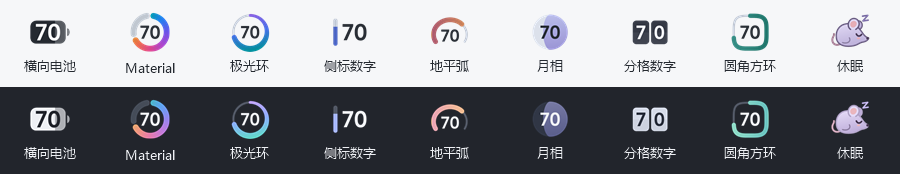

# Logi Mouse Battery

我做这个小工具，是因为看一眼 GPW 还剩多少电，原来得专门打开一次 G HUB。现在电量就放在 Windows 任务栏右下角。鼠标睡着了，数字会换成一只打盹的小鼠。

后来也加上了办公鼠标和其他品牌的蓝牙鼠标。家里放一只、包里带一只，都可以用同一个托盘图标看。



## 下载和使用

从 [Releases](https://github.com/jiabaoz-linus/logi-mouse-battery/releases/latest) 下载 Windows 压缩包，解压到打算长期存放的目录，双击 `GpwBattery.exe`。如果任务栏右下角没看到图标，点一下向上的小箭头，把图标拖到时钟旁边。

- 鼠标停在图标上，可以看型号、电量和设备提供的充电状态。
- 右键点「图标样式」可以换外观。有实际百分比时，八种样式都用当前读数预览，暂时读不到时，预览用 70%。
- 同时找到多个设备或读取来源时，右键点「显示哪只鼠标」可以指定一个。默认自动选有电量读数的鼠标。同一只罗技鼠标有时会分别出现在 G HUB 和接收器下面，菜单会标出来源。
- 想开机就看电量，右键勾选「随 Windows 登录启动」。解压后的程序可以直接用，无需管理员权限。运行环境为 Windows 10 2004 或更高版本、Windows 11 和 .NET Framework 4.8。

## 我的鼠标能显示什么？

| 连接方式 | 怎么读 | 能显示什么 |
| --- | --- | --- |
| 各品牌蓝牙鼠标 | 从 Windows 读取已配对鼠标的电量。低功耗蓝牙还会尝试标准电池服务 | 设备提供百分比时显示 0–100%。只配对、尚未连接的鼠标会显示休眠状态 |
| 罗技 G 系列 | G HUB 在本机运行时，订阅它的电量通知，并每 5 秒核对设备列表 | G HUB 报告的百分比、充电中、充满或充电异常 |
| 罗技接收器或直连设备 | 在设备支持时通过 HID++ 查询电量，覆盖常见的 LIGHTSPEED、Unifying 和 Bolt 连接方式 | 有百分比就显示数字，仅报告档位的鼠标用四格图标。只报告电压的机型显示 V，悬停可看电压 |

如果你的蓝牙鼠标已连接，菜单却写着「设备未提供可读取的电量」，可以看看 Windows 的蓝牙设置里有没有电量。有些经典蓝牙鼠标只负责传送按键和移动数据，有些厂商用自己的协议。程序会保留这个状态。纯有线、没有电池的鼠标也没有百分比可读。

兼容性按设备实际提供的数据判断。罗技接收器和蓝牙型号很多，欢迎带着**型号、连接方式、程序里看到的文字**来提 [Issue](https://github.com/jiabaoz-linus/logi-mouse-battery/issues)。蓝牙地址和序列号可以删掉。

## 从源码运行

装好 .NET Framework 4.8 和 Windows 10/11 SDK（10.0.19041 或更新）后，在仓库根目录打开 PowerShell，执行下面三行。

```powershell
.\src\build.ps1
.\src\build.ps1 -Test
.\dist\GpwBattery.exe
```

要看这次找到了哪些鼠标，可以在 PowerShell 运行 `.\dist\GpwBattery.exe --list | Out-String`。用 `--status` 查看当前选择的鼠标，用 `--tray-status` 检查 Windows 是否接收了托盘图标。蓝牙通常每 15 秒重新读取，HID++ 通常每 30 秒重新读取。

程序在本机读取设备。G HUB 接口、蓝牙和 HID++ 各自工作，有一个读不到，另外两个还可以用。字体优先使用本机安装的 MiSans，字体文件不随程序分发。

采用 [MIT 许可证](LICENSE)。这是个人项目，与罗技没有隶属关系。协议和系统接口可查阅 [罗技 HID++ 文档](https://github.com/Logitech/cpg-docs)、[Windows 设备电量属性](https://learn.microsoft.com/en-us/windows/win32/properties/props-system-devices-batterylife)和 [Windows 蓝牙 GATT 客户端文档](https://learn.microsoft.com/en-us/windows/uwp/devices-sensors/gatt-client)。
